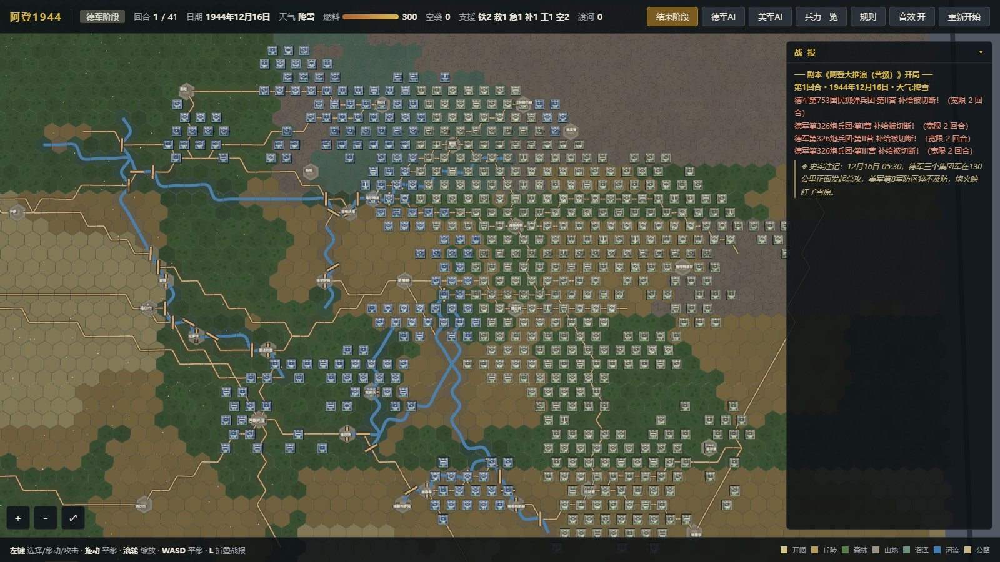
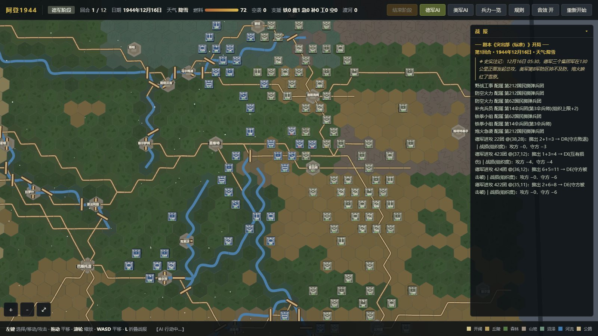
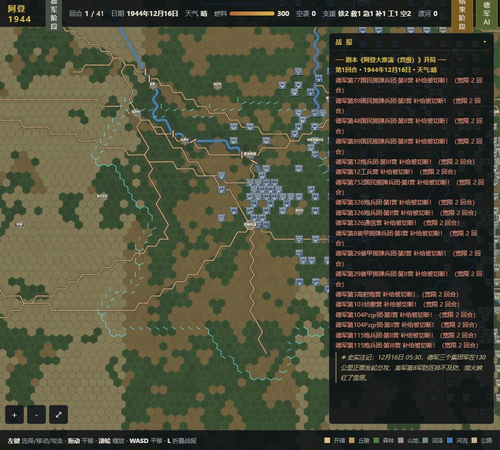

# 阿登 1944 · 大推演

**Ardennes 1944 — Grand Wargame** ｜ 营级粒度的阿登战役全域兵棋推演，跑在浏览器里。

[](LICENSE)
[](package.json)
[](package.json)
[](#-开始玩)

> **1192 个营、481 座真实城镇、21120 格六角格、41 个回合** —— 从 1944 年 12 月 16 日
> 德军三个集团军在 130 公里正面发起总攻，到 1945 年 1 月 25 日战线恢复。
> 数据驱动扩容，Three.js 渲染，构建产物是**一个 HTML 文件**，双击即玩、断网可玩。



---

## ✨ 这是什么

一个**开源、免费、无账号、无内购、无联网**的二战战役级兵棋：

| 维度 | 本作 | 常见网页兵棋 |
|---|---|---|
| 单位粒度 | **营**（1192 个真实番号建制） | 师 / 军 |
| 地图 | 220 × 96 = **21,120 格**，按真实经纬度标定 | 抽象棋盘 |
| 城镇 | **481 座**，全部真实地名（自造名 0 / 重名 0 / 重坐标 0） | 十几个要点 |
| 补给 | **成本扩散制**：逐格算地形/道路/河流代价，不是固定半径 | 距离判定 |
| 回放 | 9 个剧本、AI 对战、存档、50 项成就、245 份部队档案 | 单局 |

不是"还原一场战斗"，是**把整条战线的建制摊开打**：德军的 449 个营（含 24 个通信营、
24 个火箭炮营、14 座指挥部）对盟军的 754 个营（美 644 / 英 99），逐个进场。

## 🎮 开始玩

### 方式一：下载单文件（推荐，零依赖）

从 [Releases](../../releases) 下载 `ardennes44_big.html`，双击用浏览器打开即可。
three.js 已 gzip + base64 内联，**断网也能玩**；档案照片同样内嵌在文件里。

### 方式二：从源码构建

```bash
git clone https://github.com/yuxuanhrbeu-sketch/ardennes-1944-big.git
cd ardennes-1944-big
node build.js          # → dist/ardennes44_big.html（约 7 MB 单文件）
```

需要 Node ≥ 18，**没有任何 npm 依赖**（`node build.js` 只用到内置的 `fs` / `path` / `zlib`）。

### 方式三：在线试玩

<https://yuxuanhrbeu-sketch.github.io/ardennes-1944-big/>

> 在线版由 GitHub Actions 在每次推送时自动构建部署（见 `.github/workflows/pages.yml`）。

## 🕹️ 操作

| 输入 | 作用 |
|---|---|
| 左键 | 选择单位 / 移动 / 攻击 |
| 拖动 | 平移地图 |
| 滚轮 | 缩放 |
| `W` `A` `S` `D` | 平移 |
| `L` | 折叠 / 展开战报 |

开局：选剧本卡 **03 阿登大推演（营级）** → 选角色 → 开始推演 → 双方指挥官简报（可跳过）。
开局即在图 **605 个单位**（580 个作战营 + 25 座指挥部），其余 **612 个营**按史实入场回合增援。



## ⚔️ 规则要点

- **回合与天气**：41 个回合（1944-12-16 → 1945-01-25），逐回合天气（晴 / 阴 / 雾 / 雪）影响
  空袭、炮兵射程与移动。
- **组织度（Org）**：8 ~ 20 分层，按史实部队素质给值——党卫军装甲师 20 扛三次 DE 才崩，
  国民掷弹兵师 10 挨两下即溃。**没有血条，只有组织度数字**。
- **补给（成本扩散制）**：城镇按史实职能分三级预算（10 / 13 / 17，个别上调至 18），
  从城镇向四周扩散时按地形、道路、河流逐格扣成本。**占城即刻为占领方供补，夺回即刻翻回**。
- **荒野留白**：森林腹地 / 山脊 / 高原 / 高沼的中心地带（实测 1,595 格 = 7.6%）
  **刻意不设村庄、不被补给覆盖**——这是设计，不是 bug。
- **11 条兵种特性**：

| 兵种 | 特性 | 效果 |
|---|---|---|
| 空降（ABN/FJ） | 空降自持 | 永不受断补影响 |
| 装甲（ARM） | 装甲防护 | 无破甲火力的单位打装甲营，伤害 ×0.25 |
| 摩托化（MOT） | 公路疾驰 | 沿公路机动消耗减半 |
| 侦察（RECON） | 长驱直入 | 移动力为步兵的三倍 |
| 通信（SIG） | 通信枢纽 | 自身不断补，且作为机动补给源覆盖 3 格 |
| 火箭炮（RKT） | 覆盖齐射 | 射程 2–4、相邻为盲区、溅射邻格一半伤害 |
| 工兵（ENGR） | 就地筑垒 | 每 5 回合在所在格筑工事（防御 ×1.15，留在格上） |
| 坦克歼击（TD） | 装甲猎手 | 打装甲目标伤害 ×1.5 |
| 炮兵（ART） | 气象制约 | 雾天射程 −1 |
| 国民掷弹兵（VGD） | 乡土卫戍 | 己方城镇内受击减半；打城镇 2 格内敌军 +1 |

- **指挥部四级毁灭冲击**：军部（org 10）/ 集团军部（15）/ 总指挥部（20）被摧毁，
  所辖全部部队按级扣 org 与攻防——斩首能打瘫一段战线。
- **成就**：50 项（含 13 项"大推演"专属，如「百营之战」「斩首行动」「马斯河的影子」）。



## 🗂️ 项目结构

```
ardennes-1944-big/
├─ index.html              # 页面模板（13 个 <script> 标签，构建时内联）
├─ build.js                # 单文件构建：js/*.js + three.min.js + 照片 → dist/*.html
├─ package.json            # npm scripts（build / start / check / test）
├─ js/
│  ├─ hex.js data.js       # 六角格数学 / 基础数据与类型表
│  ├─ mapgen.js            # 地图生成（地形·高程·河流·道路·481 座城镇）
│  ├─ combat.js game.js ai.js render.js   # 战斗裁决 / 规则引擎 / AI / Three.js 渲染
│  ├─ ui.js intro.js audio.js main.js     # 界面 / 简报 / 音效 / 引导
│  ├─ data_big.js          # ★ 大推演派生层（COLS=220、TOWNS=481 在这里，手写）
│  ├─ data_big_oob.js      # ★ 自动生成，勿手改（1192 营编制）
│  ├─ dossiers_big_*.js    # ★ 部队档案 11 分片（245 份建制档案）
│  └─ achv.js achv_data.js # 50 项成就
├─ tools/
│  ├─ check_big.js         # 开局静态校验（35 项）
│  ├─ serve.js             # 零依赖本地静态服务器
│  ├─ shot.js              # 无头 Chrome 截图（QA 视觉核验）
│  ├─ gen_credits.js       # 由照片清单生成 CREDITS.md
│  └─ oob_big/             # OOB 数据管线（source/*.csv + 生成器 + 自检 29 项）
├─ qa/                     # 26 个只读 QA 核查器（不进成品）
├─ vendor/
│  ├─ three.min.js         # Three.js（经典脚本版，MIT）
│  ├─ classic/             # 原版《阿登 1944》成品（01/02 剧本用）
│  └─ photos/              # 46 张史实照片 + manifest（许可见 CREDITS.md）
├─ docs/
│  ├─ HANDOVER.md          # ★ 完整交接文档（数据契约、踩坑记录、路线图）
│  ├─ SUPPLY_POINTS.md     # 481 座城镇的补给预算表（自动生成）
│  └─ screenshots/
├─ CREDITS.md              # 素材来源与第三方许可
└─ .github/workflows/      # CI 自检 + Pages 自动部署
```

## ✅ 自检（改任何数据前先跑）

```bash
npm test     # 12 个核查器串跑，全绿才算基线正常
```

独立跑也可以：

```bash
node tools/check_big.js              # 开局静态校验 —— 35 项
node tools/oob_big/check_oob_big.js  # OOB 编制自检 —— 29 项
node qa/type_buffs_check.js          # 兵种特性 —— 38 项
node qa/town_supply_flip_check.js    # 占城补给翻转 —— 20 项
node qa/hq_command_check.js          # 指挥部体系 —— 18 项
node qa/dossier_coverage_check.js    # 档案覆盖 1192/1192 —— 17 项
```

改地图 / 城镇 / 布防后建议按 `docs/HANDOVER.md` §2 的顺序跑完整四连，
再用 `node tools/shot.js` 拍图做视觉比对。**任何一条留红就先别提交。**

## ⚠️ 已知限制

- **浏览器要求**：需要 WebGL2 + `DecompressionStream`（Chrome 103+ / Edge 103+ / Safari 16.4+ / Firefox 113+）。
  不支持时成品会自动回退到 CDN 加载 three.js，此时**需要联网**。
- **性能**：全图 765k 三角形。低端集显建议开「AI 速度：快速」并关掉阴影。
- **移动端**：可玩（触摸拖动/捏合缩放），但 220×96 全图在小屏上偏密，建议先缩放再看。
- **104 座小村镇**的坐标尚未能逐座确证（`docs/HANDOVER.md` §9），保持原状待核。
- **平衡性**：数值按史实公开资料给定，未做竞技对局调优；欢迎带数据来 issue 讨论。

## 🤝 参与

见 [CONTRIBUTING.md](CONTRIBUTING.md)。数据类改动（城镇 / OOB / 地形）请务必带上
`npm test` 的输出截图。**不要手改 `js/data_big_oob.js`**，它由 `tools/oob_big/gen_data_big.js` 生成。

## 📜 许可

- **代码与自研数据**：[MIT](LICENSE) © 2026 yuxuanhrbeu-sketch
- **历史照片**（`vendor/photos/`）：版权归原作者 / 摄影机构，**不适用 MIT**，
  按 Wikimedia Commons 各自许可引用，逐张清单见 [CREDITS.md](CREDITS.md)
- **three.js**：MIT © three.js authors

本项目仅为历史兵棋爱好者的技术演示，不代表任何政治立场。

## 🔗 相关

- 交接与设计全记录：[docs/HANDOVER.md](docs/HANDOVER.md)（1000+ 行，含数据契约与踩坑记录）
- 补给点全表：[docs/SUPPLY_POINTS.md](docs/SUPPLY_POINTS.md)
